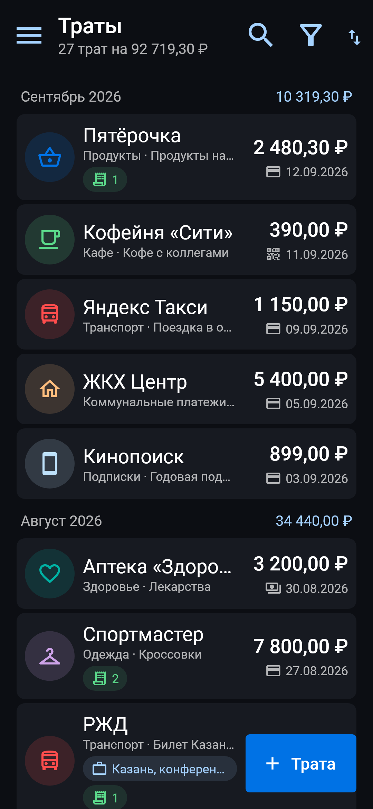
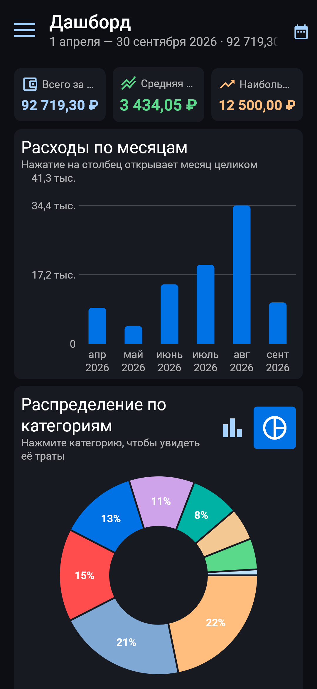
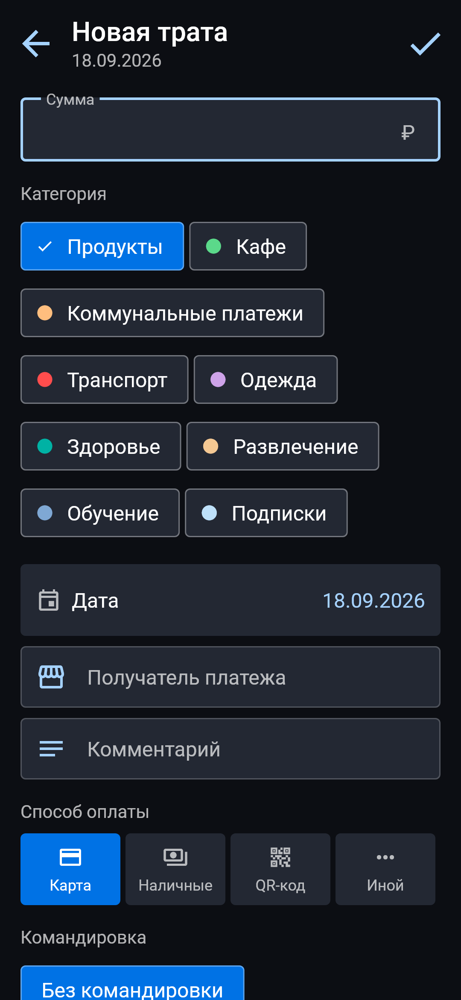
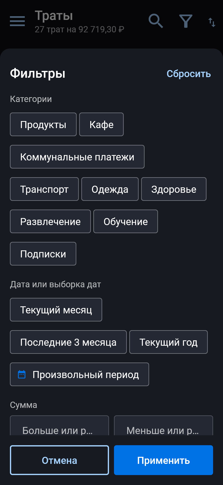
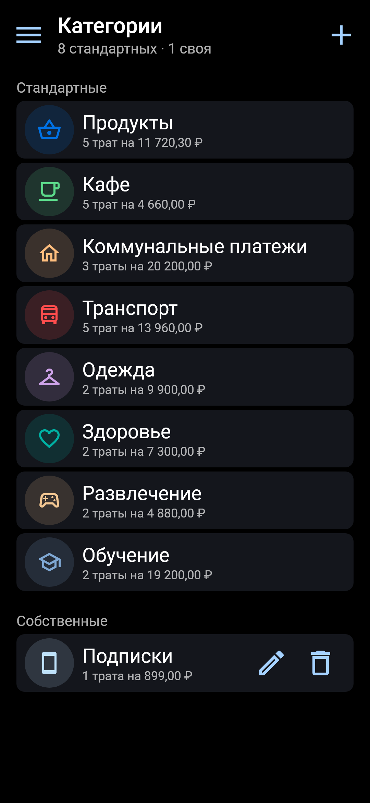
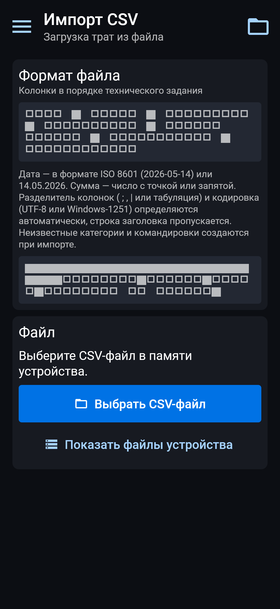
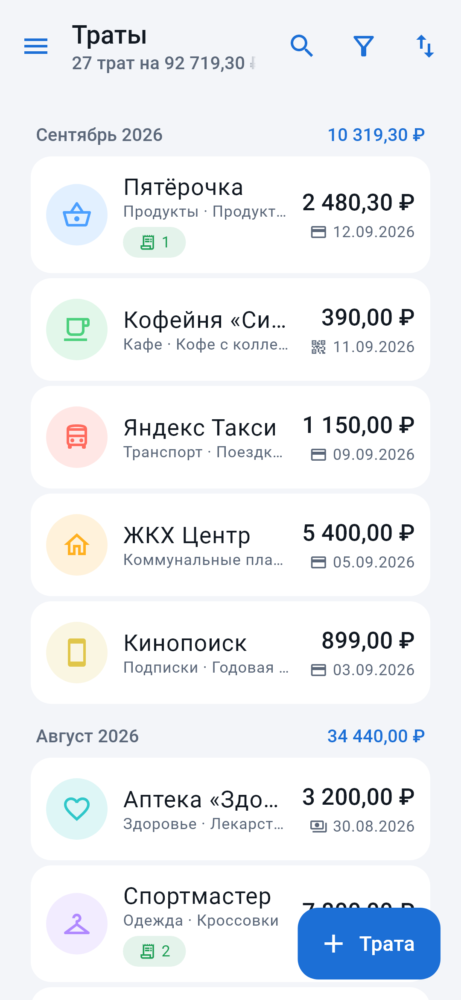
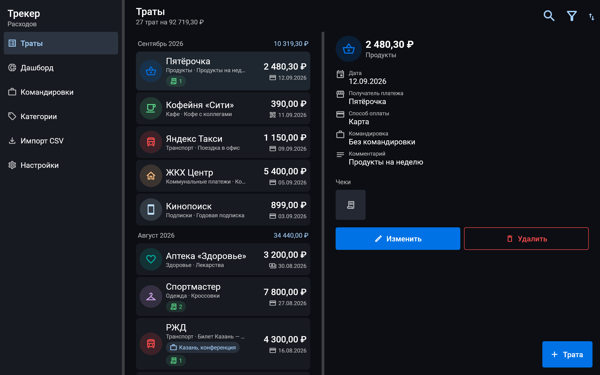
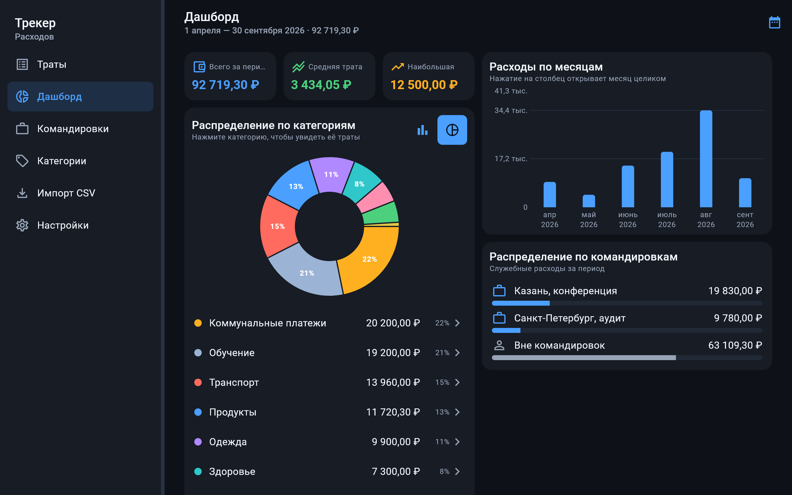
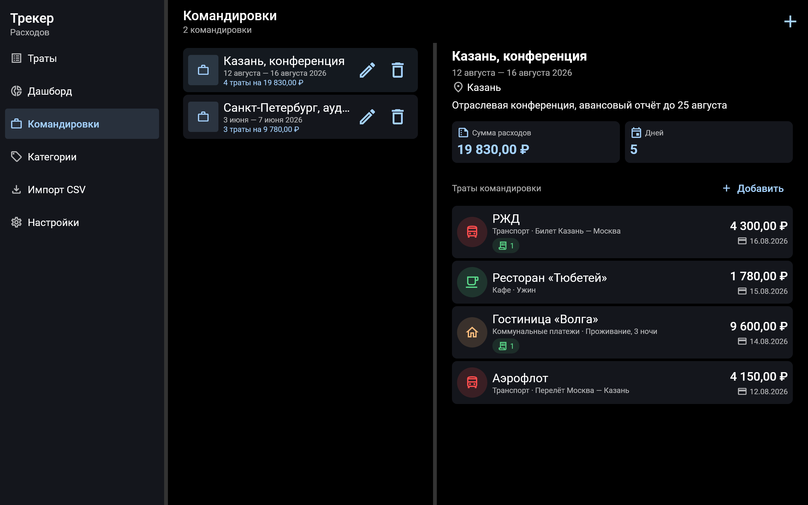

# Трекер Расходов

Мобильное приложение для ОС Аврора: учёт личных и служебных расходов —
траты с чеками, категории, командировки, импорт из CSV и дашборд
с диаграммами. Написано на Flutter, данные хранятся локально на устройстве.

Приложение рассчитано на две аудитории из технического задания:

- обычные пользователи, которые ведут домашнюю бухгалтерию;
- офисные сотрудники, которые готовят авансовые отчёты и фиксируют
  расходы в командировках.

## Скриншоты

### Смартфон

| Список трат | Дашборд | Новая трата |
| --- | --- | --- |
|  |  |  |

| Фильтры | Командировки | Категории |
| --- | --- | --- |
|  |  |  |

| Импорт CSV | Светлая схема |
| --- | --- |
|  |  |

### Планшет — многопанельный режим

| Траты | Дашборд |
| --- | --- |
|  |  |



## Возможности

### Траты

- Добавление траты вручную: сумма, категория, дата, текстовый комментарий,
  получатель платежа, способ оплаты, командировка.
- Редактирование и удаление траты.
- Прикрепление чеков: новая фотография с камеры или изображение из галереи.
  Файлы копируются в каталог данных приложения (`receipts/`), в трате
  хранится относительный путь; при удалении траты чеки удаляются вместе с ней.
- Импорт трат из локальных CSV-файлов.
- Выгрузка трат в CSV того же формата (раздел «Настройки»).

### Категории

- Восемь стандартных категорий: Продукты, Кафе, Коммунальные платежи,
  Транспорт, Одежда, Здоровье, Развлечение, Обучение.
- Создание, редактирование и удаление собственных категорий — с выбором
  иконки и цвета.
- При удалении своей категории с тратами приложение предлагает перенести
  траты в другую категорию или удалить их вместе с категорией.
- Стандартные категории защищены от удаления.

### Способы оплаты

Карта, наличные, QR-код, иной. Способ оплаты участвует в фильтрации
и в разбивке на дашборде.

### Получатель платежа

Название организации, получившей платёж. Выводится заголовком в списке трат
и участвует в поиске.

### Командировки

- Создание командировки на период: название, место назначения, даты, заметка.
- Прикрепление трат к командировке — из формы траты или из карточки
  командировки.
- Карточка командировки: период, сумма расходов, число дней и список трат.
- При удалении командировки траты сохраняются и открепляются от неё.

### Визуализация

**Общий список трат** — прокручиваемый, сгруппированный по месяцам
с итогом за каждый месяц. Фильтрация:

- по категориям (несколько сразу);
- по дате или выборке дат (текущий месяц, 3 месяца, год, произвольный период);
- по сумме — больше или меньше предела;
- по способу оплаты;
- по командировке или по её отсутствию;
- любой комбинацией перечисленного.

**Поиск** — по комментарию и по получателю платежа.

**Дашборд** — за выбранный период (месяц, 3 месяца, 6 месяцев, год, всё время
или произвольная выборка дат):

- распределение трат по месяцам — столбчатая диаграмма, нажатие на столбец
  открывает соответствующий месяц;
- распределение по категориям — круговая или столбчатая диаграмма
  с переключателем вида;
- переход из категории к списку её конкретных трат за выбранный период;
- распределение трат по командировкам;
- разбивка по способам оплаты, сумма, средняя и наибольшая трата.

## Интерфейс по гайдлайну ОС Аврора

Дизайн-система приложения повторяет значения официального UI Kit
[«Aurora Controls»](https://hub.mos.ru/auroraos/flutter/flutter-community-plugins/aurora-controls)
(ветка `flutter-aurora-3.35.7`) — того же кита, что описан
в [«Проектирование и дизайн»](https://developer.auroraos.ru/doc/5.1.1/ui_kit)
и опубликован в [Figma](https://www.figma.com/community/file/1327649212960424543/5-ui-kit-aurora-os).
Значения собраны в [`lib/core/theme/aurora_tokens.dart`](lib/core/theme/aurora_tokens.dart)
и [`lib/core/theme/aurora_colors.dart`](lib/core/theme/aurora_colors.dart),
компоненты не используют чисел помимо этих токенов.

| Группа | Значения |
| --- | --- |
| Модуль сетки | 4 px, все размеры кратны ему |
| Отступы | `paddingSmall` 4, `paddingMedium` 8, `paddingLarge` 16, поля страницы 16 |
| Иконки | 16 / 20 / 32 (`iconSizeSmallPlus`) / 44 / 64 / 84 |
| Элементы списка | 48 / 56 / 68 / 76 / 92 / 120, высота панели приложения 68 |
| Шрифт | 12 / 14 / 16 / 19 / 21 / 26 / 28, интерлиньяж 1.25, начертания 400/500/700 |
| Радиусы | 4 для кнопок и полей, 8 для карточек, 16 для модальных панелей |
| Толщина линий | 2 |

Цвета взяты из атмосферы Reef, которая в ОС Аврора используется по умолчанию:
основной текст `#FFFFFF` (в светлой схеме `#000000`), второстепенный — он же
с прозрачностью `AF`, акцент `#A5D2FF` / `#005EB5`, акцентная заливка
`#0072E5` / `#0084FF`, ошибка `#FF4D4D` / `#F62929`.

Остальное по гайдлайну:

- **Панель приложения** — заголовок с подзаголовком по левому краю,
  кнопки-иконки с целью нажатия 48×48 и иконкой 32, поле поиска
  в развёрнутом виде шириной не менее 300 dp.
- **Многопанельный режим** — на планшете и в альбомной ориентации список
  и детали показываются рядом, панели разделены сепаратором не шире 6 dp,
  панель разделов закреплена у левого края.
- **Схемы оформления** — тёмная (основная для ОС Аврора) и светлая,
  по умолчанию берётся системная, переключается в настройках.
- **Иконка приложения** — суперэллипс с безопасной зоной, размеры
  86×86, 108×108, 128×128, 172×172 ([`tool/make_icons.py`](tool/make_icons.py)).

Сам пакет `aurora_controls` в зависимости не добавлен: он помечен как
`aurora_specific_package` и требует `aurora_window_manager`, поэтому проект
с ним не собрать и не протестировать вне Аврора SDK. При сборке на SDK его
можно подключить и заменить собственные компоненты на `AuroraAppBar`,
`AuroraButton` и `AuroraTextField` — токены темы совпадают.

## Формат CSV

Колонки в порядке технического задания:

```
Дата (ISO8601) | Сумма (double) | Категория | Получатель | Способ оплаты | Комментарий | Командировка
```

Пример файла:

```csv
Дата;Сумма;Категория;Получатель;Способ оплаты;Комментарий;Командировка
2026-05-14T10:20:00;1250.50;Продукты;Магнит;Карта;Продукты на неделю;
2026-05-15;430;Кафе;Кофейня «Сити»;qr-code;Обед;Казань, конференция
```

Что приложение делает при импорте:

- определяет разделитель (`;`, `,`, `|` или табуляция) и кодировку
  (UTF-8 или Windows-1251);
- пропускает строку заголовка, если она есть;
- принимает дату в ISO 8601, а также в формате `дд.мм.гггг`;
- принимает сумму с точкой или запятой и с разделителями разрядов;
- распознаёт способ оплаты по синонимам (`карта`, `card`, `наличные`,
  `qr-code`, `иной`, …);
- создаёт неизвестные категории и командировки, период новой командировки
  охватывает даты её трат;
- показывает отчёт: сколько строк готово к импорту и какие пропущены с
  указанием номера строки и причины.

Файл выбирается системным селектором ОС Аврора. Если селектор на сборке
системы недоступен (в эмуляторе 5.2.1 он падает на разборе цвета темы,
приходящего из `aurora_window_manager`), приложение само показывает список
CSV-файлов из каталогов «Документы», «Загрузки», домашнего каталога и
съёмного носителя — кнопка «Показать файлы устройства» на экране импорта.

## Архитектура

```
lib/
├── core/
│   ├── format/      форматирование сумм, дат и склонений
│   ├── layout/      адаптация под смартфон и планшет, многопанельный режим
│   └── theme/       палитра, размерные токены и тема по гайдлайну Авроры
├── data/
│   ├── models/      трата, категория, командировка, фильтр, способ оплаты
│   ├── repositories/чтение и запись коллекций
│   ├── services/    аналитика, импорт и экспорт CSV, чеки, кодировки
│   └── store/       локальное JSON-хранилище (файловое и в памяти)
├── state/           состояние приложения и настройки
└── ui/
    ├── screens/     траты, дашборд, командировки, категории, импорт, настройки
    └── widgets/     компоненты интерфейса Авроры
```

Состояние приложения — `ChangeNotifier` поверх репозиториев (пакет
`provider`). Расчёты дашборда и разбор CSV вынесены в чистые функции
и покрыты модульными тестами.

### Хранение данных

Данные хранятся локально, в каталоге данных приложения: коллекции
`expenses.json`, `categories.json`, `trips.json` и каталог `receipts/`
с изображениями чеков. Запись атомарная — данные пишутся во временный файл
и переименовываются, поэтому прерывание работы не повреждает файл.
Доступ к хранилищу скрыт за интерфейсом `JsonStore`, что позволяет
подменять его в тестах.

## Сборка и запуск на ОС Аврора

Проверено на связке: Windows 11 → WSL2 (Ubuntu 26.04) → Flutter для ОС Аврора
3.41.4, Аврора Platform SDK 5.2.1 и эмулятор ОС Аврора 5.2.1 (QEMU).
Приложение собирается в RPM, устанавливается на эмулятор и запускается
в песочнице sailjail.

### Что поставить

Всё, кроме Windows-части, живёт внутри WSL2 — сборки «Flutter для ОС Аврора»
и Platform SDK выпускаются только для Linux и macOS.

1. **WSL2 с Ubuntu** и зеркальный режим сети. В `C:\Users\<имя>\.wslconfig`:

   ```ini
   [wsl2]
   networkingMode=mirrored
   dnsTunneling=true
   autoProxy=true
   ```

   Затем `wsl --shutdown`. Без зеркального режима из WSL не видно gitlab.com
   и pub.dev, если на Windows работает VPN.

2. **Доступ к KVM** для эмулятора — один раз от root:

   ```bash
   wsl -d Ubuntu -u root -- usermod -aG kvm <пользователь>
   ```

3. **Архиваторы** в Ubuntu: `sudo apt install bzip2 p7zip-full xz-utils`.

4. **Flutter для ОС Аврора** — `flutter_aurora_linux_3.41.4.tar.gz`
   со страницы загрузок портала; распаковать и добавить `bin` в `PATH`.

5. **Аврора Platform SDK** — chroot, tooling и target нужной архитектуры:

   ```bash
   PSDK=$HOME/AuroraPlatformSDK/sdks/aurora_psdk
   sudo mkdir -p "$PSDK"
   sudo tar --numeric-owner -p -xjf Aurora_OS-5.2.1.200-Aurora_Platform_SDK_Chroot-x86_64.tar.bz2 -C "$PSDK"
   sudo "$PSDK/sdk-chroot" -u $USER sdk-assistant tooling create -y AuroraOS-5.2.1.200-base Aurora_OS-...-Tooling-x86_64.tar.7z
   sudo "$PSDK/sdk-chroot" -u $USER sdk-assistant target create -y AuroraOS-5.2.1.200-base-x86_64 Aurora_OS-...-Target-x86_64.tar.7z
   ```

   Владельца распакованного chroot менять нельзя — иначе внутри слетает
   setuid у `sudo` и сборка падает.

6. **Правила sudoers** — их создаёт `flutter config`, но в WSL проще завести
   вручную от root (файлы должны быть читаемы пользователю):

   ```bash
   PSDK=/home/<пользователь>/AuroraPlatformSDK/sdks/aurora_psdk
   echo "<пользователь> ALL=(ALL) NOPASSWD:SETENV: $PSDK/sdk-chroot" > /etc/sudoers.d/sdk-chroot
   echo "<пользователь> ALL=(ALL) NOPASSWD:SETENV: $PSDK" > /etc/sudoers.d/mer-sdk-chroot
   chmod 0644 /etc/sudoers.d/sdk-chroot /etc/sudoers.d/mer-sdk-chroot
   ```

   Тег `SETENV` обязателен: без него инструмент не может передать
   `SSH_AUTH_SOCK` и не находит цели сборки.

7. **Эмулятор** — `standalone-emulator-5.2.1.200-linux-x86_64.7z`:
   распаковать и выполнить `./install.sh --add-alias`. Эмулятор приносит
   свой QEMU, отдельный пакет ставить не нужно.

### Сборка и запуск

```bash
flutter config --aurora-psdk-dir=$HOME/AuroraPlatformSDK/sdks/aurora_psdk
flutter doctor

flutter pub get
flutter build aurora --release --target-platform=aurora-x64    # для эмулятора
flutter build aurora --release --target-platform=aurora-arm64  # aarch64
flutter build aurora --release --target-platform=aurora-arm    # armv7hl

adt emulator start
adt deploy build/aurora/psdk_5.2.1/aurora-x64/release/RPMS/*.rpm
adt app start <идентификатор приложения>
```

RPM появляются в `build/aurora/psdk_<версия>/<архитектура>/release/RPMS/`.
Для распространения пакет подписывается ключами разработчика, выданными
«Открытой мобильной платформой».

### Платформенная часть

Каталог `aurora/` содержит иконки приложения, `desktop`-файл и
spec-файл RPM. `CMakeLists.txt`, `main.cpp` и `flutter/` тулчейн генерирует
при каждой сборке, поэтому они в `.gitignore`.

Первая строка сгенерированных `desktop` и spec-файлов — пометка
«This file will be recreated at the next build»: пока она на месте, тулчейн
перезаписывает файл. В репозитории эта строка удалена, поэтому название
приложения, описание и разрешения (каталоги пользователя, камера, съёмные
носители) зафиксированы. Если тулчейн дополнительно создаст пару файлов
с организацией по умолчанию (`com.example.*`), перед упаковкой их нужно
удалить — иначе идентификатор пакета возьмётся из них.

Реализации плагинов для Авроры отдельно подключать не нужно: тулчейн
использует pub-репозиторий ОМП, где `image_picker`, `file_selector`,
`path_provider`, `shared_preferences` и `camera` собраны с зависимостями
`*_aurora`. Поэтому ограничения версий в `pubspec.yaml` заданы так, чтобы
подходили и сборки ОМП, и обычные пакеты с pub.dev.

### Про Android Studio

Официального плагина ОС Аврора для Android Studio нет — ОМП поддерживает
расширение для VS Code. В Android Studio можно писать код, но сборку
и запуск выполняет `flutter` из дистрибутива для Авроры, а Android-эмулятор
для ОС Аврора не подходит. Для быстрой проверки интерфейса вне Авроры
приложение запускается на Android-эмуляторе (`flutter run -d <устройство>`)
или проверяется тестами вёрстки, которые снимают экраны без устройства.

## Разработка и проверка

```bash
flutter pub get
dart analyze          # ожидается «No issues found!»
flutter test          # 118 тестов: логика, состояние, вёрстка, кнопки
```

Состав тестов:

- разбор CSV, кодировки Windows-1251 и UTF-8, экспорт;
- агрегация дашборда, фильтры и поиск;
- операции состояния: траты, категории, командировки, импорт;
- вёрстка — каждый экран проверяется на шести размерах экрана
  (от 320×640 до планшета 1280×800, включая альбомную ориентацию)
  и при системном шрифте 130 %, переполнения не допускаются;
- элементы управления — кнопки не выходят за края экрана и не меньше
  цели нажатия 48×48.

Вспомогательные команды:

```bash
python tool/make_icons.py                                              # иконки приложения
flutter test tool/screenshots/screenshots_test.dart --update-goldens   # скриншоты для README
```

### Что проверено на эмуляторе ОС Аврора 5.2.1

Пакет собран под `aurora-x64`, установлен через `adt deploy` и проверен
на живой системе: добавление траты с экранной клавиатуры и её появление
в `expenses.json`, чтение данных при перезапуске, импорт CSV из каталога
устройства (10 строк, новая категория создалась), список с группировкой
по месяцам, фильтры по категории и способу оплаты, поиск, дашборд
со столбчатой и круговой диаграммами, переход из категории к её тратам,
командировки, категории, светлая и тёмная схемы, удаление траты
с подтверждением.

Указатель в эмуляторе приходит от виртуального планшета QEMU и опознаётся
Flutter как мышь, поэтому в приложении включено протягивание мышью
(`dragDevices`) — иначе списки в эмуляторе не прокручиваются.

## Лицензия

BSD 3-Clause — см. [LICENSE](LICENSE). Авторы перечислены в
[AUTHORS.md](AUTHORS.md), промпты разработки — в [PROMPTS.md](PROMPTS.md).
